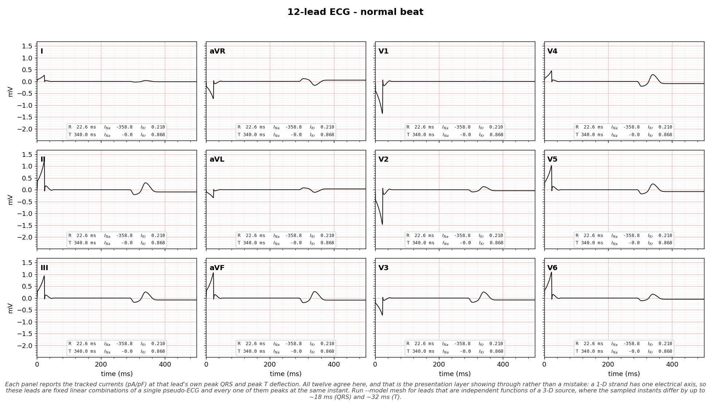
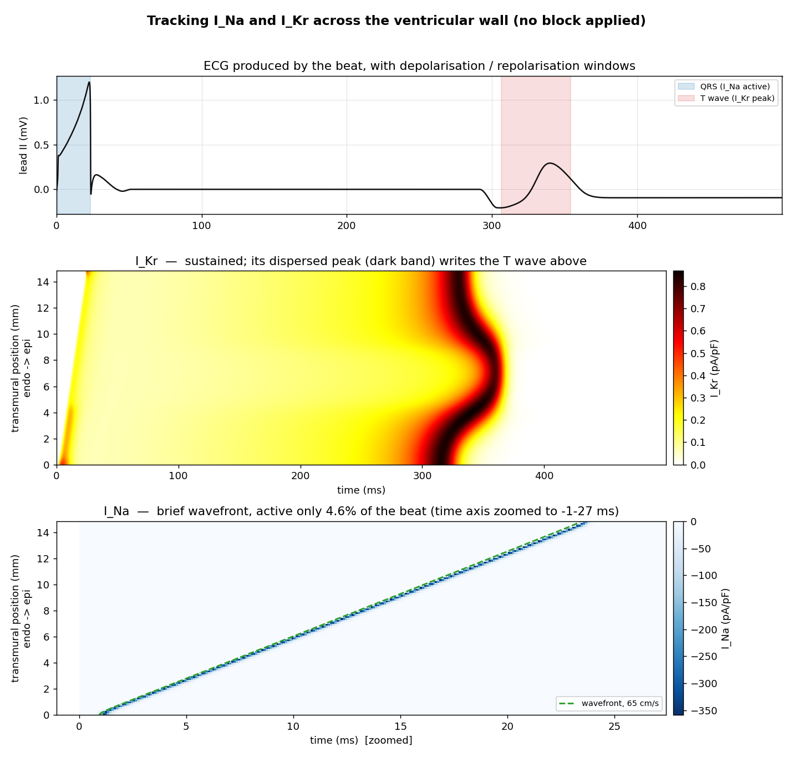
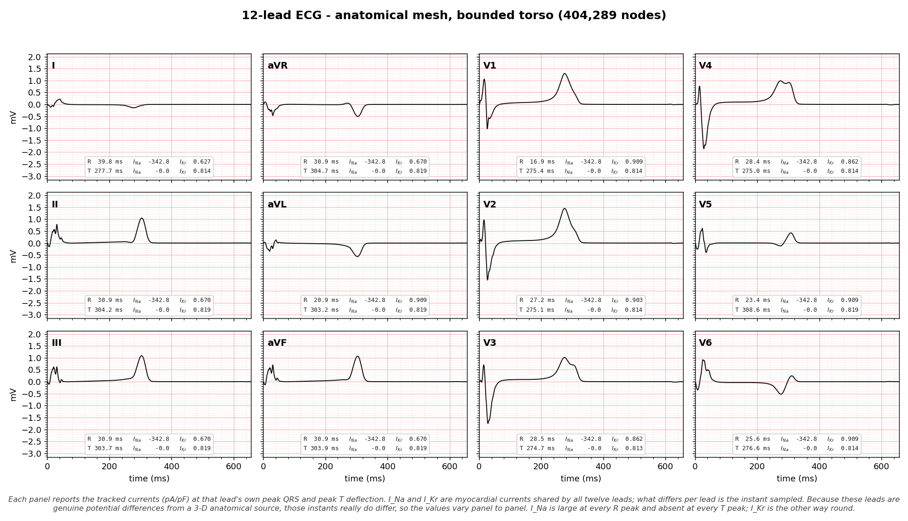

# ecg12-sim — 12-lead ECG with I_Na / I_Kr tracking

A self-contained Python project that simulates one heartbeat, generates a
**12-lead ECG**, and **tracks** the two ion-channel currents that shape it:

- **I_Na** — fast inward sodium current (drives the phase-0 upstroke → the QRS)
- **I_Kr** — rapid delayed-rectifier potassium current (drives repolarisation → the T wave)

Nothing is blocked or altered by default. The point is observational: measure
*where in the wall* and *when in the beat* each current flows, and tie that
directly to the ECG waveform the same simulation produces.

There are **two models**, sharing one ionic model and one tracking layer:

| | `--model cable` (default) | `--model mesh` |
|---|---|---|
| geometry | 1-D transmural strand, 100 cells, 1.5 cm | biventricular mesh from CT, 355k nodes / 1.85M tets |
| propagation | monodomain reaction-diffusion | anisotropic graph eikonal + fibre architecture |
| repolarisation | **emergent** from diffusive coupling | prescribed by a depth-indexed template bank |
| 12 leads | VCG dipole + Dower transform (a presentation layer) | **boundary-element forward solution in a bounded torso** |
| runtime | ~5 s | ~70 s |

The cable model is fast and shows mechanism emerging. The mesh model shows real
anatomy and produces genuinely independent leads. Neither supersedes the other,
which is why both ship.



## What the tracking shows

The two currents could not be more different in character, and tracking them
side by side makes that concrete (cable model):

| | I_Na | I_Kr |
|---|---|---|
| peak magnitude | **−359 pA/pF** | **0.87 pA/pF** (~400× smaller) |
| active fraction of the beat | **4.6%** | **74.7%** |
| spatial pattern | a narrow wavefront sweeping endo → epi | a broad, dispersed repolarisation band |
| ECG correlate | the **QRS** complex | the **T** wave |

Because I_Na fires only in cells that are actively depolarising, it appears in
space-time as a thin diagonal stripe whose slope *is* the conduction velocity
(measured here as **65 cm/s**, physiological for human ventricle). I_Kr instead
builds through the plateau and peaks as each cell repolarises; because
mid-myocardial M cells repolarise last, that peak is spread across the wall.



Measured per region for a normal beat, from each model independently:

```
cable (1-D strand)                      mesh (3-D anatomy)
region   I_Na t_peak  I_Kr t_peak        region   I_Na t_peak  I_Kr t_peak
endo           4.2        324.8          endo          27.7        344.2
mid (M)       11.2        356.3          mid (M)       34.2        380.6
epi           19.2        336.6          epi           42.1        355.2
```

Both reproduce the same two findings from completely different numerics: the
I_Na peak marches **endo → mid → epi** (the wavefront crossing the wall), while
the I_Kr peak does *not* follow that order — the **M cell peaks last**, which is
the repolarisation dispersion. The mesh times are longer because real 3-D
activation spreads over ~54 ms against the strand's 23 ms.

## Watching the currents as the ECG forms

Beyond the beat-wide summary, both models print an instant-by-instant readout:
at this millisecond, with the ECG at this voltage, what are I_Na and I_Kr doing?

```
                instant       t  signal | I_Na peak  @depth    on% | I_Kr peak  @depth    on%
                             ms      mV |     pA/pF                |     pA/pF
              QRS onset     1.0   0.172 |    -170.8    0.00   2.0% |     0.000       -   0.0%
                 R peak    22.0   1.173 |    -354.9    0.90   3.0% |     0.210    0.78  90.0%
peak I_Na + QRS end (J)    23.0   1.169 |    -358.8    0.93   3.0% |     0.210    0.82  94.0%
     T peak + peak I_Kr   340.0   0.293 |      -0.0       -   0.0% |     0.868    0.26 100.0%
```

The `@depth` column is the most informative: 0.00 is endocardium, 1.00
epicardium, and it marks where that interval's peak sat. It marches 0.00 → 0.97
straight through the QRS (the depolarisation wavefront crossing the wall) but
only drifts 0.00 → 0.45 through the T wave, because repolarisation is dispersed
rather than a sweeping front.

Rows reduce every sample since the previous row rather than sampling one instant.
That is deliberate: I_Na's wavefront crosses one cell every `dx / CV` (0.23 ms
for the default strand), so reading single instants at a 1 ms stride aliases
against the cell lattice and under-reports the peak. With binning, the table's
largest value matches the independently computed beat-wide peak exactly.

On the mesh the same reductions are **exact over all 355k nodes** without ever
storing the field. Every node's trace is one of a few template shapes shifted by
its activation time, so any spatially-summed quantity is a convolution of that
template with the histogram of activation times. Storing `Vm` outright would be
about 17 GB per field.

```bash
python main.py                          # readout with adaptive sampling
python main.py --timeline-step 25       # uniform 25 ms stride
python main.py --timeline-lead V5       # show a different lead
python main.py --no-timeline            # landmarks only
```

### On the 12-lead figures too

Every panel of the 12-lead grids carries the same two currents, sampled at
**that lead's own** peak QRS and peak T deflection:

```
R  24.4 ms   I_Na  -342.8   I_Kr  0.909
T 302.1 ms   I_Na    -0.0   I_Kr  0.818
```

I_Na and I_Kr are myocardial currents shared by all twelve leads — there is no
such thing as "lead V3's I_Na". What differs per lead is the *instant* sampled.
On the mesh that distinction has teeth: the leads are genuine potential
differences from a 3-D source, so their peaks fall up to **18 ms** (QRS) and
**32 ms** (T) apart and the sampled values vary panel to panel.

On the cable model all twelve panels show identical numbers, and that is the
presentation layer showing through rather than a bug: a 1-D strand has one
electrical axis, so its leads are fixed linear combinations of a single
pseudo-ECG and every one of them peaks at the same instant.

Two columns stay constant even on the mesh, and both are informative. I_Na is
zero at every T peak, because there is no sodium current during repolarisation.
And I_Na's peak is the same at every R peak, which is the uniform-amplitude
limitation of the template model spelled out on the figure.

### Transmural variation, as numbers

`--variation` prints how both currents vary with wall depth, for either model:

```
      depth   sites |  I_Na peak   t_peak |  I_Kr peak   t_peak
                    |      pA/pF       ms |      pA/pF       ms
0.00-0.17      17 |     -328.1      2.7 |      0.847    317.8
0.17-0.33      16 |     -332.0      6.6 |      0.861    336.7
0.33-0.50      17 |     -336.0     10.4 |      0.798    357.0
0.50-0.67      16 |     -337.4     14.2 |      0.813    354.9
0.67-0.83      17 |     -339.0     18.0 |      0.842    338.0
0.83-1.00      17 |     -330.4     21.9 |      0.831    330.1
       span         |       10.9     19.1 |      0.063     39.2
```

Each site's *own* peak is measured before averaging, never the other way round:
averaging traces first would smear I_Na's ~1 ms spike across the stagger between
neighbouring sites and under-report it by an order of magnitude. Mesh averages
are volume-weighted.

The closing lines classify the repolarisation profile by its shape rather than
asserting a result, and the two models genuinely differ. The strand reports
*"finishes latest mid-wall, at neither surface, which is the M-cell
signature"*; the mesh reports *"finishes latest at the endocardial side:
repolarisation sweeps epi → endo monotonically"*, which is the monotonic profile
its T wave requires.

## Single-cell action potential, and scaling I_Na / I_Kr

`--ap-sweep` steps back from tissue to one myocyte: the complete action
potential with every current the model carries, then each tracked conductance
scaled across levels **above and below** baseline, one current at a time.


```bash
python main.py --ap-sweep                        # 10 levels, 0.25x to 4x, epi cell
python main.py --ap-sweep --sweep-cell mid       # M cell, most I_Kr-sensitive
python main.py --ap-sweep --sweep-levels 14 --sweep-range 8
```

Note this needs *scaling*, not blocking. `Drug.from_block_percent` maps 0–100%
block onto factors at or below 1.0, so it cannot express an increase; the sweep
drives the multiplicative `Drug` fields directly, where 0.5 is a 50% block and
2.0 is a doubling. Levels are geometric about baseline, so a halving and a
doubling sit equally far from 1.0, and baseline is included exactly.


The result is a clean dissociation — each current controls a different feature
of the same waveform:

| swept 0.25× → 4× | dV/dt max | APD90 |
|---|---|---|
| **I_Na** | 121 → 900 mV/ms (**span 779**) | span 2.3 ms (±0.5%) |
| **I_Kr** | 394.7 throughout (**span 0.0**) | 324 → 273 ms (**span 51**) |

I_Na reshapes the upstroke and leaves duration alone. I_Kr leaves the upstroke
*bit-for-bit identical* and moves duration by 51 ms. Each sweep also leaves the
other current's peak unchanged, which is the check that they really are
separable. Reduced I_Kr prolonging the action potential is the mechanism behind
drug-induced QT prolongation, and it shows up here as the red curve in panel F.

The numeric table reports, per level, dV/dt max, peak Vm, APD50, APD90, percent
change in APD90 from baseline, both current peaks, and plateau voltage. Levels
that fail to produce an action potential at all are flagged rather than silently
given meaningless APD values.

## How it works

```
ionic_model.py   single ventricular myocyte: I_Na, I_CaL, I_to, I_Kr, I_Ks, I_K1, ...
     |           (ten Tusscher-style gating; I_Na and I_Kr tracked explicitly)
     |
     +-- cable.py      1-D transmural strand endo -> M-cell -> epi, diffusively
     |      |          coupled. Records Vm, I_Na, I_Kr for every cell at every
     |      |          sample, then derives the pseudo-ECG (Gima & Rudy).
     |   leads.py      pseudo-ECG -> VCG dipole -> 12 leads (Dower transform)
     |
     +-- mesh.py       loads a CT-derived biventricular mesh: LV/RV myocardium,
            |          fibre and sheet axes, universal ventricular coordinates
         eikonal.py    anisotropic activation times from fibre-aligned
            |          conduction velocities, Purkinje root points, fast
            |          endocardial shell
         templates.py  ionic model run across a ladder of transmural depths
            |          -> action potential and current templates
         mesh_sim.py   reaction-eikonal assembly: Vm(node,t) = template(t - AT)
            |          with exact spatial reductions via convolution
         torso.py      bounded homogeneous torso, boundary-element operator
            |
         forward.py    lead field -> electrode potentials -> real 12 leads

tracking.py      conduction velocity, per-region current timing and charge
timeline.py      the instant-by-instant readout, shared by both models
plotting.py      clinical 3x4 ECG grid + the three tracking views
main.py          command-line interface
```

## The anatomical mesh

`--model mesh` uses the [virtual cohort of adult healthy four-chamber heart
meshes](https://doi.org/10.5281/zenodo.4590293) (Rodero et al., **CC-BY-4.0**),
segmented from end-diastolic CT. Archives are 54–103 MB and expand to ~250 MB of
ASCII VTK, so they are fetched on demand and never committed.

```bash
python main.py --model mesh                 # downloads case 01 on first use
python main.py --model mesh --mesh-case 07  # a different subject
```

Mesh runs write `ecg12_mesh.png`, the 3×4 clinical grid of the bounded-torso
leads with the per-lead current annotations described above.



Reduced to LV + RV myocardium, case 01 gives:

```
  nodes / tetrahedra  : 355,095 / 1,849,092
  LV / RV tetrahedra  : 1,340,385 / 508,707
  bounding box (cm)   : 11.6 x 10.6 x 11.7
  myocardial volume   : 224.5 cm^3
  median tet edge     : 1.01 mm
```

The median edge length of 1.01 mm matches the cohort's documented 1 mm, and the
myocardial volume is physiological for biventricular myocardium. Downloads are
verified against the record's published MD5 checksums.

The cohort's **universal ventricular coordinates** do real work here. The
transmural coordinate replaces the strand's `frac = i / (n_cells - 1)` index
heuristic with a true wall depth at every node, so endo / M / epi heterogeneity
can be assigned anywhere in a 3-D wall; the apico-basal and rotational
coordinates place Purkinje root points reproducibly across subjects.

## Validation

Each layer is checked against something independent rather than inspected:

| component | test | result |
|---|---|---|
| mesh parse | median tet edge vs documented 1 mm | 1.01 mm |
| velocity tensor | speed along fibre / sheet / 45° vs analytic | 65.000000 / 25.000000 / 49.2443 vs 49.2443 |
| graph metrication | isotropic probe where arrival = distance / speed | 1.0829 path inflation (effective 60.0 vs 65 cm/s) |
| FEM gradients | recover a known linear field | exact to 4e-13 |
| spatial reductions | convolution identity vs brute force over all nodes | identical to 4 decimals |
| nodal volumes | sum vs total tet volume | 224.47 = 224.47 cm³ |
| anatomical frame | 6 independent anatomy checks | 6/6 |
| **boundary element** | **dipole in an insulating sphere (analytic 3×)** | **3.0116, converging** |
| total activation time | physiological 80–100 ms | 54 ms (see limitations) |

The boundary-element test is the sharpest one. A current dipole at the centre of
a homogeneous insulating sphere produces surface potentials exactly **three
times** the unbounded-medium value, and recovering that pins the operator's
constant, its sign and the solid-angle assembly all at once:

```
  sphere verts    amplification (exact 3.0)   residual
       258              3.0504                0.0173
       578              3.0212                0.0073
      1026              3.0116                0.0040
      1602              3.0073                0.0025
```

## Why the torso boundary matters

The mesh model's first forward solution placed electrodes in an **unbounded**
medium. That is fatal for the limb leads, and the reason is physics rather than
numerics: a dipole field falls as 1/r², so electrodes 28–40 cm away read a small
fraction of what the precordial electrodes at 8–11 cm see. A real torso is
bounded by insulating air, so current cannot escape and must circulate within
the body, lifting surface potentials well above the free-space value.

| | unbounded | bounded torso |
|---|---|---|
| limb / precordial peak-to-peak | 0.041 | **0.416** |
| lead II peak-to-peak | 0.096 mV | **1.500 mV** |
| aVF peak-to-peak | 0.099 mV | **1.581 mV** |

A real ECG has that ratio around 0.3–1.0. Measured boundary amplification is
~2.9×, consistent with the sphere's analytic 3×.

```bash
python main.py --model mesh              # bounded torso (default)
python main.py --model mesh --unbounded  # old behaviour, for comparison
```

Coupling the BEM to the source naively would need a 602 × 355,095 weight matrix
(1.7 GB). Instead the source compresses onto (template, activation-bin) pairs —
a few thousand, against 355k nodes — and each template's bin weights convolve by
FFT.

## Morphology checks

The mesh model's leads are checked against textbook features of a normal ECG.
These are the real validation of the forward geometry: lead polarity and
precordial progression follow from where electrodes sit relative to the heart's
electrical axis, so a wrong frame or a wrong activation sequence shows up here.

```
  [PASS] aVR QRS area is negative                 -2.96 mV.ms
  [PASS] II QRS area is positive                  +3.94 mV.ms
  [PASS] V1 QRS more negative than V6
  [FAIL] precordial progression mostly monotonic  2 of 5 steps increasing
  [PASS] T wave upright in II                     +38.16 mV.ms
  [PASS] T wave upright in V5                     +11.51 mV.ms
  5 of 6 checks pass
```

QRS polarity is judged by net **area**, not the largest excursion: the single
extreme sample flips sign arbitrarily on a biphasic RS complex.

The one failure is documented rather than tuned away. See limitations.

## Install & run

```bash
cd ecg12-sim
python3.12 -m venv .venv
source .venv/bin/activate
pip install -r requirements.txt

python main.py                      # cable model: ECG + I_Na / I_Kr tracking
python main.py --model mesh         # anatomical mesh + bounded-torso 12 leads
python main.py --duration 600       # longer beat
python main.py --cells 200          # finer transmural resolution
python main.py --no-save            # print the metrics table only
```

### CLI options

| option | meaning | default |
|--------|---------|---------|
| `--model` | `cable` or `mesh` | `cable` |
| `--duration` | simulated time in ms | 500 |
| `--cells` | cells across the wall (cable) | 100 |
| `--outdir` | output directory for PNGs | `examples` |
| `--no-save` | print metrics, write no files | off |
| `--no-timeline` | suppress the per-instant table | off |
| `--timeline-step` | uniform readout stride in ms | adaptive |
| `--timeline-lead` | lead shown in the readout | `II` |
| `--variation` | print the transmural variation table | off |
| `--variation-bands` | depth bands in that table | 9 |
| `--ina-block` | *optional* I_Na block percent | 0 (none) |
| `--ikr-block` | *optional* I_Kr block percent | 0 (none) |

Single-cell sweep options:

| option | meaning | default |
|--------|---------|---------|
| `--ap-sweep` | complete AP + I_Na / I_Kr conductance sweeps | off |
| `--sweep-cell` | `endo`, `mid` or `epi` | `epi` |
| `--sweep-levels` | conductance levels, geometric about baseline | 10 |
| `--sweep-range` | largest scale factor (smallest is its reciprocal) | 4.0 |

Mesh-only options:

| option | meaning | default |
|--------|---------|---------|
| `--mesh-case` | cohort case 01–20 | `01` |
| `--mesh-file` | path to a cohort `.vtk`, bypassing `--mesh-case` | — |
| `--mesh-dir` | download / cache directory | `data/meshes` |
| `--templates` | transmural depths in the template bank | 15 |
| `--cv-fibre` | conduction velocity along fibre, cm/s | 65 |
| `--cv-transverse` | transverse conduction velocity, cm/s | 25 |
| `--endo-cv` | fast endocardial shell, cm/s (0 disables) | 600 |
| `--torso-theta` | circumferential torso resolution | 24 |
| `--unbounded` | skip the torso, unbounded medium | off |
| `--calibrate-metrication` | correct the graph's path-length bias | off |

The two block options are opt-in extras, off by default. Supplying one runs a
second, blocked beat and prints it against the normal one — useful as a sanity
check that each current does what the tracking says it does.

## Using it as a library

```python
from ecg12sim import run_12lead, analyse, Drug

ecg = run_12lead(Drug())            # Drug() with no arguments = nothing blocked
rep = analyse(ecg.cable)
ecg.cable.I_Na                      # (n_samples, n_cells) field, pA/pF
rep.conduction_velocity, ecg.qt     # 65.0 cm/s, 353 ms
```

```python
from ecg12sim import run_ap_sweep, run_complete_ap, format_sweep_table

t, V, traces, met = run_complete_ap(cell_type="epi")
met.apd90, met.dvdt_max                         # 310.3 ms, 394.7 mV/ms
traces["I_Kr"]                                  # every current is here

res = run_ap_sweep("I_Kr", scales=(0.25, 0.5, 1.0, 2.0, 4.0))
print(format_sweep_table(res))
[m.apd90 for m in res.metrics]                  # 324.3 ... 272.9 ms
```

```python
from ecg12sim import (fetch_mesh, load_ventricular_mesh, run_mesh_beat,
                      run_12lead_bem, check_morphology)

mesh = load_ventricular_mesh(fetch_mesh("01"))
beat = run_mesh_beat(mesh)                      # reaction-eikonal, reduced form
res = run_12lead_bem(beat)                      # bounded-torso 12 leads
res.leads["V5"]                                 # mV
res.amplification()                             # boundary gain vs unbounded
check_morphology(res.leads, beat.qrs_window, beat.t_window, beat.t)
```

## Scientific scope and honest limitations

This is a **teaching / demonstration** model, not a validated clinical tool.

**Shared by both models**

- The ionic model keeps I_Na and I_Kr as faithful, explicit ten Tusscher-style
  currents, but holds ion concentrations fixed and uses a simplified linear
  L-type Ca term, so it is smaller and faster than a full ten Tusscher–Panfilov
  or O'Hara–Rudy model.
- Each simulation is a single beat from rest, not a rate-adapted steady state,
  so absolute APD and QT values are approximate.
- `ionic_model.initial_state` starts the I_Kr inactivation gate `xr2` at 1.0,
  where its resting steady state is 0.481. Every other gate starts within ~2% of
  equilibrium. The template bank works around this by pre-equilibrating for
  50 ms; the cable model does not, though its coupled cells are affected much
  less because electrotonic loading keeps their overshoot lower.

**Cable model**

- A single 1-D strand has only one electrical axis, so the **12-lead fan-out is
  a presentation layer**: the depolarisation and repolarisation phases of the
  genuine transmural pseudo-ECG are mapped to a vectorcardiographic dipole and
  projected with the standard Dower transform. Lead-specific morphology is
  realistic but it is not a forward solution.
- The splice between the two phases leaves the lead II T wave biphasic and the
  trace ending about 0.09 mV off baseline.

**Mesh model**

- Geometry is image-derived and genuinely anatomical, but the **fibre
  architecture is rule-based** (80° endocardium to −60° epicardium), not
  measured per subject.
- Propagation is a **graph eikonal**, so conduction velocity is prescribed
  rather than emergent — the cable model remains the one that *measures* 65 cm/s
  from its own wavefront. Graph paths cannot cut through tetrahedra, which
  inflates path length by a measured factor of 1.0829; `--calibrate-metrication`
  corrects it.
- Each node's action potential is a shifted template, so **repolarisation is
  prescribed, not emergent**, and **I_Na amplitude is uniform** (−342.8 pA/pF
  everywhere) because amplitude cannot respond to local coupling the way it does
  in the cable (−330 / −336 / −335 by region). What the mesh retains is timing,
  which is what drives the ECG.
- Because there is no electrotonic coupling to compress it, an M-cell APD island
  is exaggerated and makes repolarisation **core-last and symmetric**, which
  cancels the T wave instead of writing it. The mesh model therefore uses a
  **monotonic** transmural APD profile (a 58 ms decrease endo → epi) with only a
  modest M signature. A node repolarises at `activation + APD`, activation rises
  ~18 ms across the wall, so APD must fall by more than that, monotonically, for
  repolarisation to sweep epi → endo at all. This is an explicit trade of
  M-cell detail for a T wave that exists.
- The fast endocardial shell (600 cm/s) is a **surrogate for a whole Purkinje
  network**, not a myocardial velocity. It is calibrated for lead morphology:
  at lower values activation stays apex-to-base dominated and the frontal-plane
  leads invert. The cost is total activation falling to 54 ms, below the
  physiological 80–100 ms window.
- The torso is **homogeneous** — one conductivity, no separate lung, blood or
  skeletal-muscle regions — and its surface is **parametric adult anatomy**, not
  a segmented subject. The boundary itself is the dominant correction, but
  tissue inhomogeneity is not represented.
- **The precordial R-wave progression is wrong** (the one failing morphology
  check). Measured QRS axis is (+0.43 left, −0.87 posterior, −0.25 inferior):
  far too posterior, where a normal axis is dominantly leftward. A dipole
  pointing that posteriorly points away from the anterior electrodes, so V2–V4
  come out deeply negative and the progression is V-shaped rather than
  monotonic. The most likely cause is residual rotational calibration of the
  anatomical frame about the heart's long axis — the frame's six anatomy checks
  constrain signs but not angles, and a rotation of 20–30° would preserve all of
  them while swinging the transverse axis between leftward and posterior. This
  has **not** been tuned away, because fitting the frame to make the ECG look
  right is exactly what the Dower presentation layer already does.

### References (methods this draws on)

- ten Tusscher & Panfilov, *Alternans and spiral breakup in a human ventricular
  tissue model*, Am J Physiol Heart Circ Physiol, 2006 — ionic-current gating.
- Gima & Rudy, *Ionic current basis of electrocardiographic waveforms*, Circ Res,
  2002 — pseudo-ECG from a transmural strand.
- Dower et al., 1980 — vectorcardiogram ↔ 12-lead (Dower) transform.
- Neic et al., *Efficient computation of electrograms and ECGs in human whole
  heart simulations using a reaction-eikonal model*, J Comput Phys, 2017 —
  the reaction-eikonal construction.
- Durrer et al., *Total excitation of the isolated human heart*, Circulation,
  1970 — earliest-activation sites used for the Purkinje root points.
- Van Oosterom & Strackee, *The solid angle of a plane triangle*, IEEE Trans
  Biomed Eng, 1983 — exact solid angles for the boundary-element operator.
- Rodero et al., *Linking statistical shape models and simulated function in the
  healthy adult human heart*, PLOS Comput Biol, 2021 —
  [the mesh cohort](https://doi.org/10.5281/zenodo.4590293), CC-BY-4.0.
